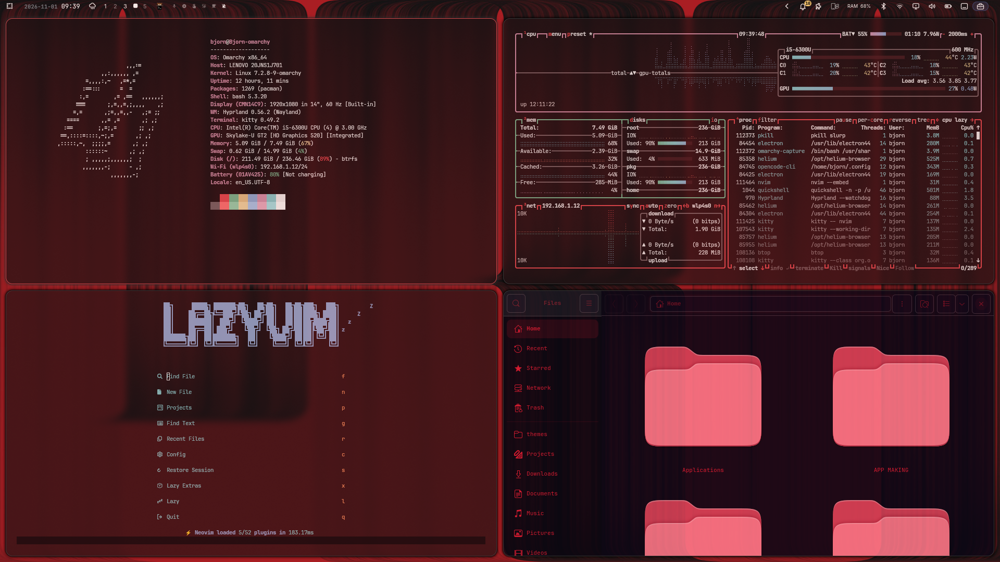

# Red Mac

A dark, warm-crimson theme for [Omarchy](https://omarchy.org) — near-black
surfaces, a crimson accent, and warm off-white text. Built from the *red mac*
wallpaper set, with 18 wallpapers included.



## Install

Omarchy can install a theme straight from a git repository:

```bash
omarchy theme install https://github.com/bjorksander-netizen/omarchy-red-mac-theme.git
```

The theme is cloned into `~/.config/omarchy/themes/red-mac` and applied
immediately. Later updates:

```bash
omarchy theme update
```

Or pick it from the switcher:

```bash
omarchy theme switcher
```

### Manual install

```bash
git clone https://github.com/bjorksander-netizen/omarchy-red-mac-theme.git \
  ~/.config/omarchy/themes/red-mac
omarchy theme set red-mac
```

### Bahasa Indonesia

```bash
omarchy theme install https://github.com/bjorksander-netizen/omarchy-red-mac-theme.git
```

Omarchy akan meng-clone tema ini ke `~/.config/omarchy/themes/red-mac` dan
langsung mengaktifkannya. Ganti wallpaper dengan `omarchy theme bg next`.

## Palette

| Role            | Color     |
| --------------- | --------- |
| background      | `#1a0e10` |
| dark background | `#150a0c` |
| darker          | `#0f0607` |
| lighter surface | `#2c1719` |
| foreground      | `#f4e6e3` |
| accent          | `#e5484d` |
| selection       | `#4a1d20` |
| muted           | `#7f5f60` |

The accent is the wallpaper red (`#a91e23`) brightened for legibility on the
near-black surfaces; secondary ANSI colors are warm and desaturated so terminal
output stays distinguishable without breaking the monochrome-red mood.

## What's inside

| File          | Purpose                                                        |
| ------------- | -------------------------------------------------------------- |
| `colors.toml` | The whole theme. Omarchy generates terminal, btop, GTK, editor, shell and app colors from these values. |
| `backgrounds/` | 18 wallpapers, cycled with `omarchy theme bg next`.            |
| `icons.theme` | Icon theme to pair with it (`Yaru-red-dark`).                   |
| `preview.png` | 1920x1080 preview used by the theme switcher.                   |

## Backgrounds

All 18 wallpapers from the source folder are included and cycle with
`omarchy theme bg next` (two-digit names sort in the original order, square
`1x1-*` variants come last):

| File        | Source          | Size      | Brightness (0-255) |
| ----------- | --------------- | --------- | ------------------ |
| `01.png`    | `1.png`         | 2048x1024 | 39                 |
| `02.png`    | `2.png`         | 2048x1024 | 51                 |
| `03.png`    | `3.png`         | 2048x1024 | 39                 |
| `04.png`    | `4.png`         | 2048x1024 | 50                 |
| `05.png`    | `5.png`         | 2048x1024 | 51                 |
| `06.png`    | `6.png`         | 2048x1024 | 38                 |
| `07.png`    | `7.png`         | 2048x1024 | 66                 |
| `08.png`    | `8.png`         | 2048x1024 | 23                 |
| `09.png`    | `9.png`         | 2048x1024 | 52                 |
| `10.png`    | `10.png`        | 2048x1024 | 37                 |
| `11.png`    | `11.png`        | 2048x1024 | 70                 |
| `12.png`    | `12.png`        | 2048x1024 | 19                 |
| `13.png`    | `13.png`        | 2048x1024 | 52                 |
| `14.png`    | `14.png`        | 2048x1024 | 52                 |
| `1x1-1.png` | `_1 1x1.png`    | 4000x4000 | 48                 |
| `1x1-2.png` | `_2 1x1.png`    | 4000x4000 | 41                 |
| `1x1-3.png` | `_3 1x1.png`    | 4000x4000 | 24                 |
| `1x1-4.png` | `_4 1x1.png`    | 4000x4000 | 66                 |

## Icons

`Yaru-red-dark`. Install it from the Omarchy icon picker if you want the
matching folder icons.

## License

The theme configuration (`colors.toml`, `icons.theme`, this README) is released
under the MIT License — see [LICENSE](LICENSE).

The wallpapers in `backgrounds/` are **not** covered by that license. They were
collected from a third-party "red mac" wallpaper pack, and the original
copyright belongs to their authors. They are bundled here so the theme looks
complete; redistribute them at your own discretion.
